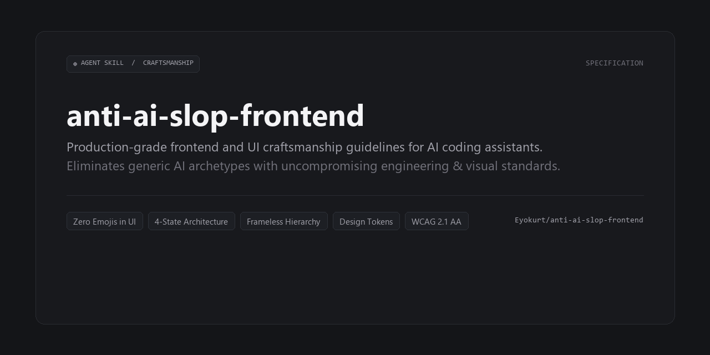

# Anti-AI-Slop Frontend Craftsmanship



> Production-grade frontend and UI craftsmanship guidelines for AI coding assistants. Eliminates generic "AI slop" and enforces clean aesthetics, strict semantic HTML, complete 4-state components, SVG-only iconography, authentic copy, and modern CSS/Tailwind discipline.

[](LICENSE)
[](SKILL.md)

---

## What is "AI Slop" in Frontend Code?

LLMs and AI coding assistants naturally gravitate toward predictable, generic frontend archetypes:
- **Neon purple/violet glowing drop shadows** on pitch-black surfaces
- **Emoji spam** embedded directly into buttons, badges, and headers (`<button>🚀 Get Started</button>`, `<span>✨ New</span>`)
- **Hallucinated placeholder file paths** (``, `src="/avatar.jpg"`)
- **Unsemantic div soup** with inaccessible `<div onClick={...}>` handlers
- **Happy-path blindness**: Omitting loading skeletons, empty zero-data states, and error recovery screens
- **AI marketing buzzwords**: *"Unlock the power of..."*, *"Elevate your experience"*, *"Seamless integration"*
- **Generic 3-card layouts** repeated on every section
- **Over-compensation**: Building hyper-dense sci-fi dashboards or textbook-style pages when pushed away from standard templates

This skill establishes balanced design and engineering standards to produce human-crafted, accessible, and resilient frontend interfaces.

---

## Core Principles & Directives

### 1. Aesthetic Intent First (Avoid Default Archetypes)
Before writing markup or CSS, determine an intentional aesthetic direction tailored to the product and target audience:
- **Clean Grotesque / High-Density Utility**: Tight data tables, crisp monochromatic borders, neutral surfaces, functional monospace accents (e.g., developer tools, financial consoles).
- **Warm Humanist Editorial**: High-contrast serif headlines, warm stone/linen backgrounds, generous whitespace, relaxed leading (e.g., publications, bespoke services).
- **Industrial Precision**: Deep neutral surfaces, technical line dividers, stark typography, restrained functional accents (e.g., hardware, manufacturing, logistics).
- **Vibrant Neo-Clean**: Soft pastel accents on pure white/neutral canvases, rounded geometry, punchy high-contrast typography (e.g., consumer fintech, modern SaaS).

### 2. Iconography & Emoji Boundaries
- **UI Chrome Zero-Emoji Rule**: Never place emojis (🚀, ✨, 🔥, ⚡, 🎉, 💡, ❌, ✅, 👉) inside buttons, status badges, section headings, table headers, toasts, or navigation links.
- **UGC Exemption**: Emojis are permitted inside actual user-submitted content (chat messages, reviews, comments).
- **Monochromatic Vector SVGs**: Use dedicated icon libraries (Lucide React, Heroicons, Phosphor, Radix, Tabler).
- **Color Inheritance**: Icons must inherit color via `currentColor` to harmonize with theme shifts.
- **Accessibility**: Decorative icons must have `aria-hidden="true"`; standalone icon buttons require `aria-label`.

### 3. Placeholder & Mock Asset Hygiene
- **No Hallucinated Paths**: Never link to non-existent local files.
- **Avoid Fragile External Domains**: Avoid unvetted external placeholder domains (`picsum.photos`, etc.) which fail under strict CSPs or ad-blockers. Use inline clean SVG illustrations or geometric background patterns.
- **Avatar Initials Fallback**: Always implement initials fallbacks (e.g., `<div className="size-8 rounded-full ...">EK</div>`) instead of raw broken `` tags.
- **Form Placeholders**: Input placeholders are strictly for syntax/format hints (e.g., `alex@company.com`), never labels or instructions.
- **Zero Lorem Ipsum**: Write realistic, domain-specific copy matching the application context.
- **Realistic Data Variance**: Introduce organic variation in statuses, timestamps, and non-round numbers in data tables and feeds.

### 4. Visual Philosophy & Surface Hierarchy
- **No Cliché Neon Gradients**: Avoid default dark mode surfaces dominated by saturated purple/violet glowing drop shadows.
- **Grounded Base Palette**: Use natural off-blacks (`#0a0a0a`, `#121212`, `#0f172a`), balanced neutrals, and at most **one** deliberate brand accent.
- **Subtle Surface Steps**: Separate elevation through subtle contrast steps rather than harsh 1px borders around every element.
- **WCAG Contrast Compliance**: Ensure text meets WCAG 2.1 AA standards (minimum 4.5:1 contrast for regular text; 3:1 for large headings/UI boundaries). Never pair low-contrast muted gray text with faint dark surfaces.
- **Viewport Stability**: Prefer `min-h-dvh` over `100vh` or `h-screen` to eliminate layout bouncing on mobile browser address bar shifts.
- **Typography Discipline**: Pair typography deliberately with the product archetype. Use `text-wrap: balance` on headlines, `text-wrap: pretty` on body copy, and `tabular-nums` on metric counters.

### 5. Semantic HTML, Accessibility & Interactive States
- **Strict Div-Button Ban**: Interactive elements must be semantic `<button type="button">` or `<a href="...">`.
- **Semantic Landmarks**: Structure pages using `<nav>`, `<header>`, `<main>`, `<aside>`, `<section>`, `<article>`, `<figure>`, and `<footer>`.
- **Interactive Control States**: Every interactive control must handle default, `:hover`, `:focus-visible` (visible ring indicator), `:active` (micro-feedback, e.g. `active:scale-95`), and `:disabled`.
- **Form Controls**: Explicit `<label htmlFor="...">` bindings, grouped `<fieldset>` blocks, and `aria-describedby` error associations.

### 6. Async Lifecycle States (Loading / Empty / Error / Success)
Every component that handles async data or operations must account for all four lifecycle states:
1. **Loading State**: Content-shaped skeleton loaders (`animate-pulse`) mirroring real content (no solitary center spinners).
2. **Empty State**: Friendly zero-data visual explaining what belongs here + actionable primary CTA.
3. **Error State**: Non-blocking inline error banner with an explicit retry button.
4. **Success State**: Clean data-rendered presentation free from transition layout shifts.

### 7. CSS & Tailwind Discipline
- **Token Consistency**: Stick strictly to design tokens (`w-80`, `text-muted-foreground`, `rounded-xl`). Avoid arbitrary pixel hacks like `w-[347px]`.
- **Z-Index Scale**: Maintain a clean, predictable layering hierarchy (`z-10`, `z-20`, `z-50`).
- **No Class Bloat**: Break 80+ character utility strings into small, focused subcomponents or compound styles.

### 8. Motion & Animation Restraint
- **Respect `prefers-reduced-motion`**: Always provide a reduced-motion fallback (`motion-reduce:transition-none motion-reduce:animate-none`).
- **Hardware Acceleration**: Only animate GPU-accelerated properties (`transform`, `opacity`). Never animate layout triggers (`width`, `height`, `margin`).
- **Snappy Micro-interactions**: Keep transitions short and snappy (150ms–250ms with `ease-out`). Avoid sluggish, floaty animations.

### 9. Copywriting Authenticity (Anti-Buzzword Policy)
- Banned AI marketing clichés: *"Unlock the power of"*, *"Supercharge your workflow"*, *"Next-gen solution"*, *"Elevate your experience"*, *"Delve into"*, *"Game-changer"*.
- Replace buzzwords with clear, active, and concrete product capabilities.

### 10. Editorial Restraint & Anti-Overengineering
When avoiding generic templates, models often over-compensate. Follow these guidelines:
1. **Zero Dynamic Layout Shift (CLS)**: Reserve minimum heights (`min-h-*`) or CSS grid rows for dynamic containers so text variations never shift buttons or layout.
2. **Frameless Hierarchy**: Banish "border soup". Let headlines and actions sit directly on the page surface using whitespace and tonal steps.
3. **Audience-Centric Tone**: Match the emotional frequency of the demographic (do not turn a consumer app into an aerospace cockpit).
4. **Scope-Aware Metrics**: High data variance belongs in dashboards, not unrequested metric dumps on marketing pages.
5. **No Cheap Hover Zooms**: Prohibit `hover:scale-105` on image cards. Use tranquil static presentation or subtle opacity shifts.
6. **No Generic Category Pill Tabs**: Present collections through curated editorial showcases or horizontal rails instead of blog-style pill bars.
7. **Grid Uniformity Ban**: Avoid repetitive identical cards. Use asymmetric arrangements and featured hero cards.
8. **Card Simplicity**: Limit cards to at most 2 typographic roles (headline + short supporting sentence).
9. **Visual-First Economy**: Promotional pages are not user manuals. Limit sections to 1 primary headline and 1-2 punchy sentences.
10. **Zero Chapter Numbering**: Never prefix sections with textbook labels like `"Section 01"` or `"Chapter 2"`.

---

## Installation & Usage

### Google Antigravity / Gemini CLI
Clone or copy this skill into your Antigravity skills directory:

```powershell
# Global skill directory
git clone https://github.com/Eyokurt/anti-ai-slop-frontend.git "$HOME\.gemini\config\skills\anti-ai-slop-frontend"
```

Or copy the `SKILL.md` directly into your workspace:
```bash
mkdir -p .gemini/skills/anti-ai-slop-frontend
cp SKILL.md .gemini/skills/anti-ai-slop-frontend/
```

### Claude Code
Add the skill to your project's `.claude/skills` directory:

```bash
mkdir -p .claude/skills/anti-ai-slop-frontend
cp SKILL.md .claude/skills/anti-ai-slop-frontend/SKILL.md
```

Or include a directive in your `CLAUDE.md`:
```markdown
Whenever writing frontend code or UI components, follow the anti-ai-slop-frontend craftsmanship rules in .claude/skills/anti-ai-slop-frontend/SKILL.md.
```

### Cursor & Windsurf
Add the rules from [`SKILL.md`](SKILL.md) to `.cursorrules` or `.windsurfrules`.

---

## Pre-Flight Verification Checklist

Before presenting frontend code or declaring a UI task complete:

- [ ] **No Emojis in UI**: Are all buttons, badges, headers, and navigation links 100% free of Unicode emojis?
- [ ] **No Broken Images**: Are all `` tags pointing to verified URLs, inline SVGs, or initials fallbacks (no hallucinated paths)?
- [ ] **Semantic Buttons**: Are all clickable controls actual `<button>` or `<a>` tags (zero `<div onClick>`)?
- [ ] **Accessible Focus**: Can the interface be navigated with `Tab` and `Enter`/`Space` with clear `focus-visible` indicators?
- [ ] **Reduced Motion**: Are animations paired with `motion-reduce:transition-none`?
- [ ] **Contrast Compliant**: Does text meet WCAG 2.1 AA contrast requirements against its background?
- [ ] **Async Lifecycle Handled**: Did you account for Loading (Skeleton), Empty, Error (with retry), and Success states on data components?
- [ ] **Interactive States Covered**: Do interactive controls have distinct feedback for hover, focus-visible, active, and disabled?
- [ ] **No Dynamic Layout Shift**: Do dynamic text containers have reserved minimum heights to prevent surrounding jumps?
- [ ] **Frameless Hierarchy**: Is the layout free of unnecessary nested borders ("border soup")?
- [ ] **No Cheap Hover Zooms**: Are image cards free of `hover:scale-105` clichés?
- [ ] **No Section Numbering**: Are section titles free of textbook labels like "Section 01" or "Chapter 2"?
- [ ] **No Marketing Buzzwords**: Is the copy concise, authentic, and free of generic AI hype words?

---

## License

This project is licensed under the [MIT License](LICENSE).
